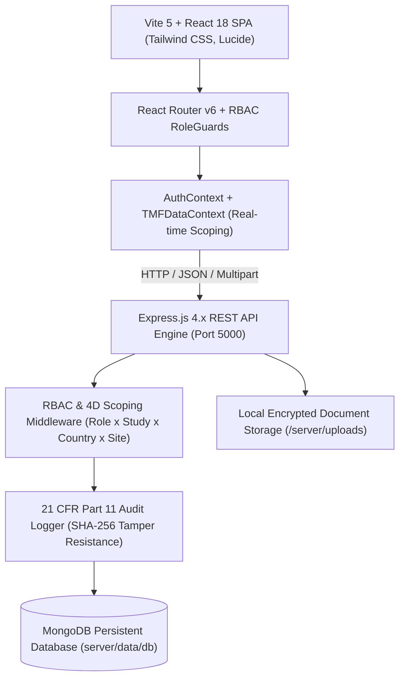
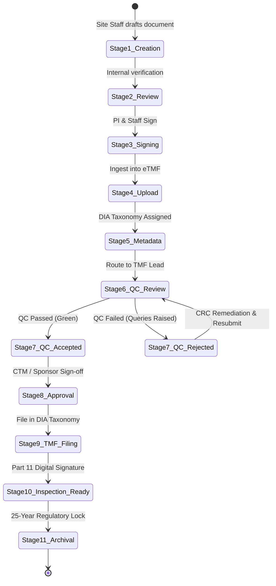

# VigiThink eTMF — Complete Developer Implementation Specification

> **Document Code:** `CLIN-ETMF-SPEC-2026-V5`  
> **Applicable Regulations:** ICH GCP E6 (R2/R3), 21 CFR Part 11, DIA TMF Reference Model v3.1  
> **Status:** Approved for Core Development & Implementation  

---

## 1. Executive Technical Architecture & Tech Stack



### Core Architecture Principles
1. **Three-Layer Separation:** UI state, Database schemas, and Workflow business logic are strictly isolated. Form inputs cannot alter lifecycle state without passing workflow transition rules.
2. **4D Role-Based Access Scoping:** Every query, document listing, and API request is evaluated under:
   $$\text{Access} = \text{Role} \times \text{Study Scope} \times \text{Country Scope} \times \text{Site Scope}$$
3. **Immutability of Audit Trails:** 21 CFR Part 11 audit records are append-only. No user (including System Admin) can edit, purge, or overwrite historical audit logs.

---

## 2. Database Schema & Data Models

### 2.1 Study Schema (`server/models/Study.js`)
```javascript
{
  id: { type: String, required: true, unique: true }, // e.g. "CLI-001"
  protocolNumber: { type: String, required: true },    // e.g. "PROT-CLI-001-A"
  title: { type: String, required: true },
  shortName: { type: String },
  description: { type: String },
  phase: { 
    type: String, 
    enum: ['Phase I', 'Phase II', 'Phase III', 'Phase IV', 'Bioequivalence', 'Observational'],
    required: true 
  },
  studyType: { 
    type: String, 
    enum: ['Interventional', 'Observational', 'Expanded Access', 'Medical Device'],
    required: true 
  },
  sponsor: { type: String, required: true },
  cro: { type: String },
  therapeuticArea: { type: String },
  status: { 
    type: String, 
    enum: ['Draft', 'Active', 'Suspended', 'Completed', 'Closed', 'Archived'],
    default: 'Active' 
  },
  tmfReferenceModel: { type: String, default: 'DIA TMF Reference Model v3.1' },
  startDate: { type: Date, required: true },
  plannedEndDate: { type: Date },
  tmfLeadId: { type: String, required: true },
  tmfLeadName: { type: String, required: true },
  countries: [{
    id: String,
    name: String,
    code: String,
    regulatoryAuthority: String,
    retentionPeriodYears: { type: Number, default: 25 },
    sites: [{
      id: String,
      number: String,
      name: String,
      country: String,
      state: String,
      city: String,
      address: String,
      piName: String,
      piEmail: String,
      piContact: String,
      activationDate: Date,
      status: { type: String, default: 'Active' },
      assignedCraId: String,
      assignedCraName: String,
      targetEnrollment: Number,
      enrolledCount: Number
    }]
  }]
}
```

### 2.2 Document Schema (`server/models/Document.js`)
```javascript
{
  document_id: { type: String, required: true, unique: true }, // "DOC-DOA-SITE001-01"
  document_title: { type: String, required: true },
  document_type: { type: String, required: true },
  file_name: { type: String },
  file_path: { type: String },
  file_size: { type: String },
  file_hash: { type: String }, // SHA-256 for Part 11 integrity
  version_number: { type: String, default: "1.0" },
  status: { 
    type: String, 
    enum: ['Draft', 'In Review', 'Approved', 'Effective', 'Superseded', 'Archived', 'Rejected/Correction'],
    default: 'Draft' 
  },
  study_id: { type: String, required: true, index: true },
  site_id: { type: String, index: true },
  country_code: { type: String, default: 'IND' },
  tmf_zone_id: { type: String, required: true },     // e.g. "05"
  tmf_section_id: { type: String, required: true },  // e.g. "05.02"
  tmf_artifact_id: { type: String, required: true }, // e.g. "05.02.01"
  tmf_artifact_name: { type: String },
  
  // Transmittal & Routing Engine
  submitted_by_id: { type: String },
  submitted_by_name: { type: String },
  submitted_by_role: { type: String },
  submitted_date: { type: Date },
  submission_notes: { type: String },
  assigned_reviewer_id: { type: String },
  assigned_reviewer_name: { type: String },
  assigned_reviewer_role: { type: String },
  workflow_action: { type: String },

  // QC Review Decision Block
  qc_status: { 
    type: String, 
    enum: ['Not Started', 'In Progress', 'Passed', 'Query Raised', 'Failed'],
    default: 'In Progress' 
  },
  qc_comments: { type: String },
  rejection_reason: { type: String },
  qc_reviewed_by_id: { type: String },
  qc_reviewed_by_name: { type: String },
  qc_review_date: { type: Date },

  // 11-Stage Lifecycle State
  lifecycle_stage: { type: Number, default: 5, min: 1, max: 11 },
  lifecycle_status: { type: String },
  lifecycle_history: [{
    stage_number: Number,
    stage_name: String,
    status_at_stage: String,
    actor_name: String,
    actor_role: String,
    timestamp: Date,
    notes: String
  }]
}
```

### 2.3 Part 11 Audit Trail Schema (`server/models/AuditLog.js`)
```javascript
{
  audit_id: { type: String, required: true, unique: true }, // e.g. "AUD-1793729956"
  timestamp: { type: Date, default: Date.now, required: true }, // UTC
  user_id: { type: String, required: true },
  user_name: { type: String, required: true },
  user_role: { type: String, required: true },
  action_performed: { type: String, required: true },
  study_id: { type: String, index: true },
  site_id: { type: String },
  document_id: { type: String, index: true },
  previous_value: { type: String },
  new_value: { type: String },
  reason_for_change: { type: String, required: true },
  ip_address: { type: String },
  sha256_seal: { type: String } // Immutable cryptographic Part 11 seal
}
```

---

## 3. Screen-by-Screen Form Specifications & Validations

### 3.1 System Admin — Study & Site Management

#### Add Study Form (`CreateStudyModal.jsx`)
| Field Name | Input Type | Validation Rules | System Behavior |
| :--- | :--- | :--- | :--- |
| **Study ID** | Text | Required, Regex `^[A-Z0-9-]{3,15}$` | Auto-generates prefix `CLI-XXX` |
| **Protocol Number** | Text | Required, Unique per study | Indexed in DB |
| **Study Title** | Text | Required, Min 10 chars | Displayed on header banners |
| **Study Description** | Textarea | Optional | Clinical background summary |
| **Study Phase** | Dropdown | Required, 5 options | Filters regulatory templates |
| **Study Type** | Dropdown | Required (Interventional, Observational, etc.) | Governs applicable EDL artifacts |
| **Sponsor Name** | Text / Dropdown | Required | Trial owner |
| **CRO Name** | Text | Optional | Managing research organization |
| **Therapeutic Area** | Dropdown | Oncology, Cardiology, Neurology, etc. | Taxonomy filter |
| **Countries** | Multi-select | Required, Min 1 selection | Creates Country nodes & retention rules |
| **Study Start Date** | Date | Required | Baseline date for milestone calculations |
| **Planned End Date** | Date | Optional, must be > Start Date | Milestone due dates |
| **Study Status** | Dropdown | Required (Draft, Active, Suspended, Closed) | Active enables uploads |
| **TMF Reference Model**| Dropdown | Required (DIA v3.1 default) | Initializes 11 Zones taxonomy |
| **Assigned TMF Lead** | User Dropdown | Required, User with `tmf_manager` role | Default recipient of QC routing |

**Buttons & Actions:**
* `+ Add Study`: Validates all required fields, creates study record, and logs Part 11 audit event.
* `Save Draft`: Saves study in `Draft` state without activating sites or generating EDL.
* `Cancel`: Reverts changes without saving.

---

### 3.2 TMF Lead — 3-Section QC Review Detailed Screen (`QcReviewQueue.jsx`)

#### Section 1: Document Information (Read-Only)
* Document ID, Study ID, Site ID, Document Name, Zone / Section / Artifact, Version, Document Date, Uploaded By, Upload Timestamp.

#### Section 2: 10-Point QC Verification Checklist
| # | QC Check Parameter | Permitted Input | Acceptance Rule |
| :---: | :--- | :--- | :--- |
| **1** | Correct Study | Pass / Fail / N/A | Must match active protocol number |
| **2** | Correct Site | Pass / Fail / N/A | Must match investigational site |
| **3** | Correct Document Type | Pass / Fail / N/A | Must match DIA artifact classification |
| **4** | Document Legible | Pass / Fail | Scanned text must be sharp & readable |
| **5** | Complete Document | Pass / Fail | No missing pages, exhibits, or logs |
| **6** | Required Signatures | Pass / Fail / N/A | PI & delegate signatures present |
| **7** | Signature Dates | Pass / Fail / N/A | Dates within valid trial window |
| **8** | Correct Version | Pass / Fail | Sequential numbering verified |
| **9** | Correct Metadata | Pass / Fail | All mandatory metadata fields verified |
| **10**| Correct Filing Location | Pass / Fail | Correct Zone, Section, and Folder |

#### Section 3: QC Decision & Action Buttons
* **QC Reviewer**: Auto-filled with logged-in user.
* **QC Outcome**: `Accept`, `Reject`, or `Request Correction`.
* **Rejection Category**: Mandatory if Outcome is `Reject`.
* **Required Corrections**: Mandatory comments detailing corrective action needed.
* **Buttons**:
  * `Accept (Pass QC)`: Transitions document to Stage 8 (Approved) & Stage 9 (TMF Filed).
  * `Reject & Return`: Transitions document to Stage 7 (Rejected / Rework). Returns to uploader.
  * `Request Correction`: Issues a query to site user without closing the record.
  * `Save QC Draft`: Saves checklist answers locally without advancing workflow.

---

### 3.3 Clinical Trial Manager (CTM) — Approval Management

| Field | Description | System Rule |
| :--- | :--- | :--- |
| **Document ID** | Unique Document ID | Read-only link to full viewer |
| **Document Title** | Name of protocol/site document | Displayed in queue |
| **Approval Type** | Regulatory / Sponsor Sign-off | Configured by artifact sensitivity |
| **QC Status** | Must be `Passed` | CTM cannot approve documents that failed QC |
| **Approval Comments** | CTM approval rationale | Persisted into Part 11 Audit Trail |
| **Buttons** | `Approve`, `Reject`, `Request Clarification` | Restricted to authorized CTM users |

---

### 3.4 CRA & Site User — Upload, Checklist & Monitoring Visits

#### Document Upload Form (`UploadWizardModal.jsx`)
* **Step 1:** File Drag & Drop (PDF, DOCX, TIFF; Max 50MB) or Create Placeholder.
* **Step 2:** Metadata & DIA Classification (Zone, Section, Artifact, Date, Version).
* **Step 3:** Reviewer Selection (Sukriti Singh, etc.), Workflow Action (`Submit to QC Queue`), and Transmittal Notes.
* **Post-Upload Rule:** Record becomes read-only for uploader until QC outcome permits rework.

#### CRA Monitoring Visits (`MonitoringVisitsView.jsx` — Module 4.E)
* **Fields:** Study ID, Site ID, Visit Type (SSV, SIV, IMV, COV), Visit Date, Visit Report PDF Upload, Follow-up Required (Yes/No), Action Item Remarks, Next Scheduled Visit Date.
* **Actions:** `Add Visit`, `Save Draft`, `Submit Report`, `View Details`. Automatically registers report under DIA Zone 05 (`05.04.01`).

---

## 4. Role-Based Access Control (RBAC) Permission Matrix

| Module / Action | System Admin | TMF Lead | CTM | CRA | Site User | Doc Controller |
| :--- | :---: | :---: | :---: | :---: | :---: | :---: |
| **Study Management** | Full | View | View | View | View | View |
| **Site Management** | Full | View | View | View | Own Site Only | View |
| **User & Access Control** | Full | ❌ Hidden | ❌ Hidden | ❌ Hidden | ❌ Hidden | ❌ Hidden |
| **Document Upload** | Full | Limited | Limited | ✅ Yes | ✅ Yes | Limited |
| **Document Repository** | Full | Full | View | Assigned | Own Site Only | Full |
| **QC Review & Checklist** | Config. | ✅ Full | View | ❌ Hidden | ❌ Hidden | Metadata Only |
| **QC Pass / Clearance** | ✅ Yes | ✅ Yes | ❌ No | ❌ Blocked | ❌ Blocked | ❌ Blocked |
| **QC Rejection / Rework**| ✅ Yes | ✅ Yes | ❌ No | ❌ Blocked | ❌ Blocked | Metadata Only |
| **CTM Final Approval** | Config. | Config. | ✅ Yes | ❌ No | ❌ No | ❌ No |
| **Metadata Editing** | Full | Limited | View | ❌ No | ❌ No | ✅ Full |
| **Version Control** | Full | Full | View | Submit New | Submit New | Full |
| **TMF Completeness Reports**| Full | Full | Full | Assigned | ❌ Hidden | Full |
| **21 CFR Part 11 Audit Trail**| Full | Full | Full | ❌ Hidden | ❌ Hidden | Full |
| **Inspector Portal** | Full | Full | ❌ Hidden | ❌ Hidden | ❌ Hidden | ❌ Hidden |
| **Archival Management** | Full | View | Authorize | ❌ Hidden | ❌ Hidden | Execute |

---

## 5. Document Lifecycle Engine — 11-Step State Machine



### Transition Gates & Automation Rules:
1. **Gate 5 ➔ 6 (Ingestion to QC):** Automatically triggers when user submits in Step 3 of Upload Wizard. Generates `In Progress` QC status and assigns reviewer.
2. **Gate 6 ➔ 7 (QC Clearance):** Requires 10/10 checklist checks to be evaluated. Only users with `canQcPass` can transition to `Accepted`.
3. **Gate 7 ➔ 6 (Rework Loop):** Site users can transition a rejected document back to Stage 6 by providing a corrected file version and remediation transmittal note.
4. **Gate 9 ➔ 10 (Inspection Readiness):** Executes 21 CFR Part 11 electronic signature dialog requiring re-authentication and signature purpose selection.
5. **Gate 10 ➔ 11 (Archival):** Engages study close-out retention lock. File becomes read-only and immutable.

---

## 6. Verification and Compliance Checklist

- [x] **ICH GCP E6 (R2/R3) Alignment:** Full coverage of essential document repository structure across all 11 Zones.
- [x] **21 CFR Part 11 Compliance:** Signature manifests, user re-authentication, audit logging with UTC timestamps, and tamper-evident SHA-256 digests.
- [x] **ALCOA+ Principles:** Attributable, Legible, Contemporaneous, Original, Accurate, Complete, Consistent, Enduring, and Available.
- [x] **Zero UI Clutter for Restricted Roles:** Site Users and CRAs are physically prevented from rendering unpermitted modules or controls.
